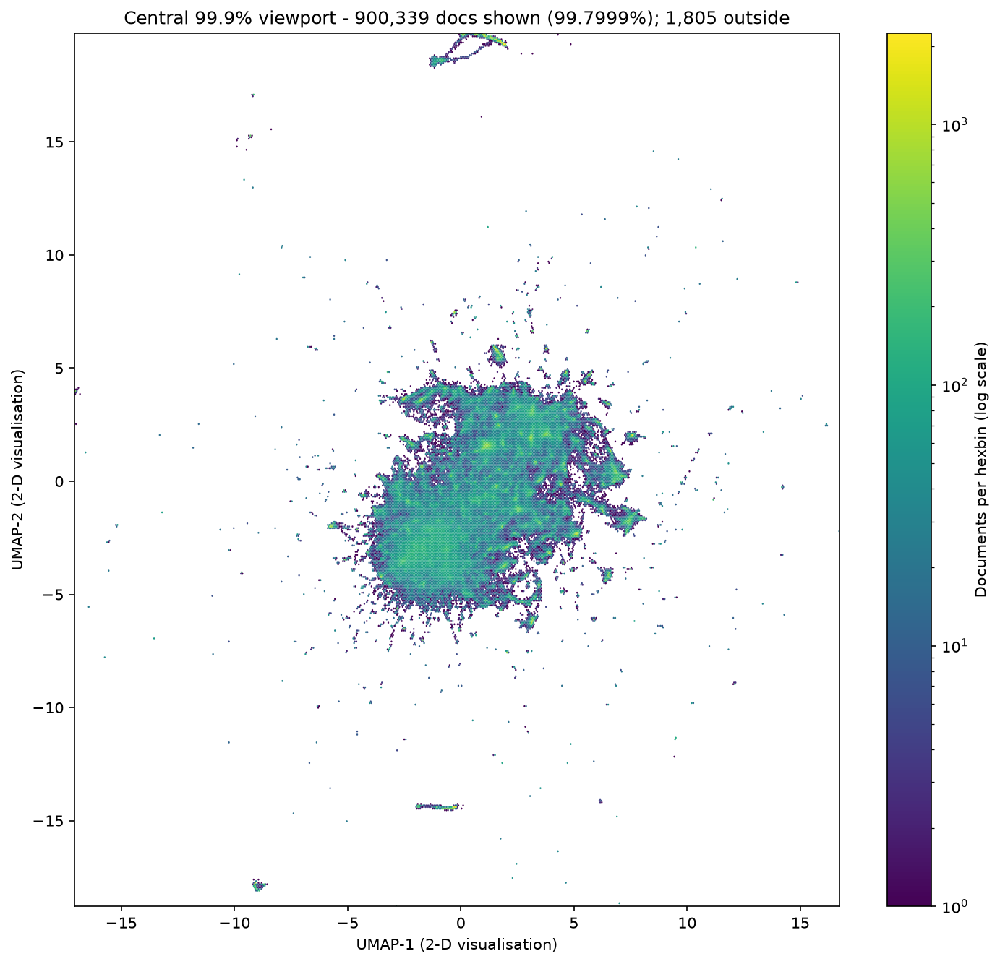

# karma-cartography

[](https://github.com/SpencerTye/karma-cartography/actions/workflows/tests.yml)

Mapping what a Reddit community talks about, by meaning rather than by keywords.

This pipeline takes one month of a large community (every post and comment in `r/politics`,
July 2026: **902,144 messages**), embeds each message with a transformer model, and finds its
semantic structure with GPU UMAP and HDBSCAN. The goal is to track how narratives and disinformation
move between online communities and change over time. The approach adapts methods I use to integrate high-dimensional
biological data (multi-omics) to text.

I built it as a volunteer analyst for [Digital Ground Game](https://digitalgroundgame.org),
a nonprofit that holds the full historical Reddit corpus (~40 TB). This month is the
development sample; the pipeline is being validated here before it scales to the full corpus.



## Pipeline

| Phase | Language | What it does | Status |
|---|---|---|---|
| [1. Message-event foundation](pipeline/phase1_message_event_foundation/) | R | Raw Parquet files → one canonical table: one row per message, stable keys, explicit thread and reply links, provenance | done |
| [2. Semantic embeddings](pipeline/phase2_semantic_embeddings/) | Python | Qwen3-Embedding-0.6B via Text Embeddings Inference on the GPU; all 902,144 messages in 15 minutes | done |
| [3. Structure discovery](pipeline/phase3_blind_semantic_structure_discovery/) | Python | cuML UMAP + HDBSCAN on the GPU; 5,167 clusters in about two minutes | done |
| [4. Cluster description and QC](pipeline/phase4_semantic_structure_description_qc/) | R | c-TF-IDF keywords, representative messages, per-cluster metadata, automated checks, manual-review sample | in progress |
| 5+. Change over time, threads, links, coordination | | | planned |

Results and methods for each phase are in [`docs/METHODS.md`](docs/METHODS.md).

## Highlights

- **Measured, not guessed.** Model size, batch size and memory limits were each settled by a
  dedicated feasibility study before the full run (`pipeline/phase2_semantic_embeddings/`).
- **`vram_cap`**, a small C library that caps a program's GPU memory by standing in for the
  CUDA driver. Text Embeddings Inference has no such setting, so I wrote one
  ([`vram_cap.c`](pipeline/phase2_semantic_embeddings/feasibility_tei_qwen3_4b_batch_tokens/scripts/vram_cap/vram_cap.c)).
- **Provenance everywhere.** Inputs are read-only and hashed before and after every run, and
  every output carries a sidecar with input, output and script hashes, parameters and
  package versions.
- **Verified outputs.** Every stage checks its own results: row counts, key alignment,
  finite values, and token totals reconciled to the source.

## Repository layout

```
pipeline/       the four phases; each step has scripts/, tests/ and a README
legacy/         the earlier topic-model approach (LDA, STM) in R, kept for reference
environment/    Python requirements per stage, and an R package installer
docs/           methods and results, data dictionary
```

Data, results and model files are not in the repository (see `.gitignore`).

## Running it

Requirements: R 4.5 for Phases 1 and 4; Python 3.12 with CUDA 12 for Phases 2 and 3 (run
under WSL2 Ubuntu 24.04 on an RTX 3090); Docker with the NVIDIA Container Toolkit for Text
Embeddings Inference.

```bash
# R packages
Rscript environment/install_r_packages.R

# Python environments (one per GPU stack)
pip install -r environment/requirements-embeddings.txt
pip install -r environment/requirements-clustering.txt
```

Place the Reddit Parquet files under `data_sample/` (comments and submissions for the month;
see the Phase 1 README for the exact layout), then run the phases in order. Each step's README
gives its exact command, inputs, outputs and the checks that show it succeeded. Scripts find
the repository root on their own; set `KC_REPO_ROOT` to override.

## Tests

The pure functions of every step have unit tests that run without a GPU, data or models:

```bash
pip install -r environment/requirements-tests.txt
pip install torch --index-url https://download.pytorch.org/whl/cpu
python pipeline/phase2_semantic_embeddings/full_corpus_embedding_0p6b/tests/test_embed_full_corpus_functions.py
Rscript pipeline/phase1_message_event_foundation/tests/test_phase1_functions.R
```

All tests run automatically on every push ([workflow](.github/workflows/tests.yml)).

## License

MIT. Code by Spencer Tye ([spencertye.me](https://spencertye.me)).
