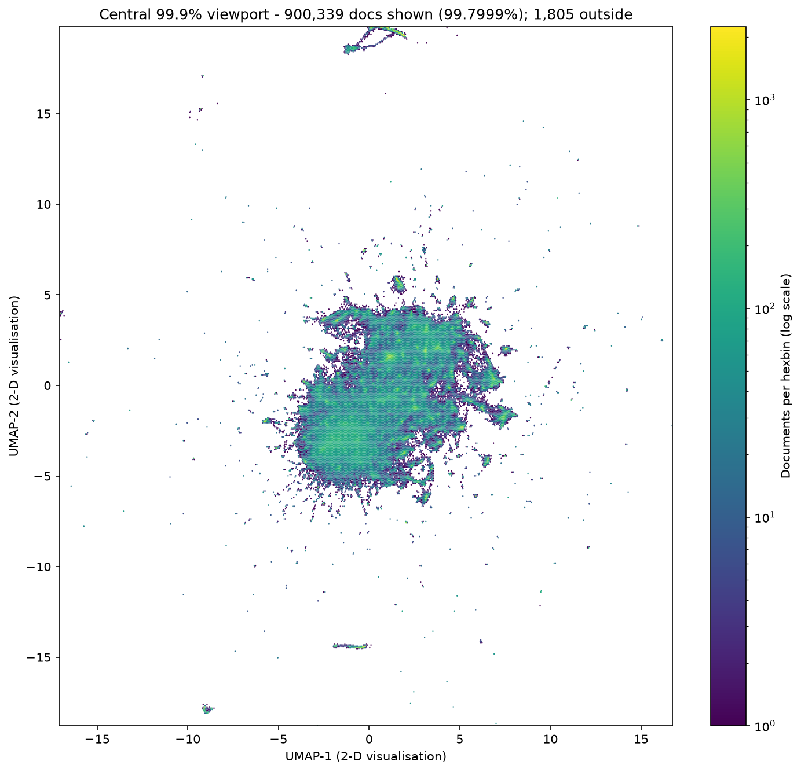
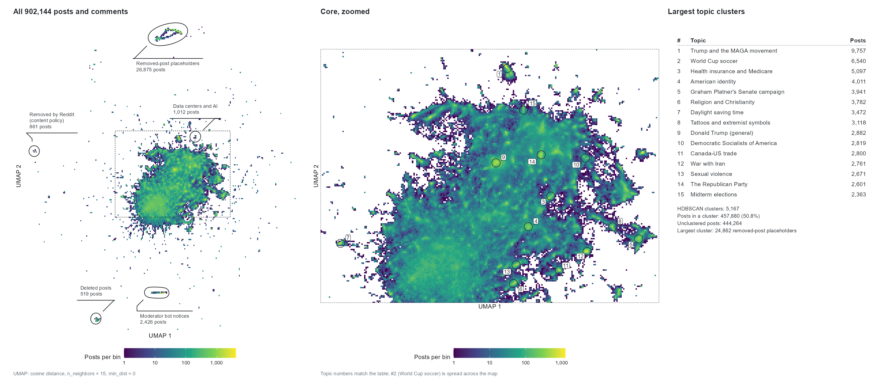
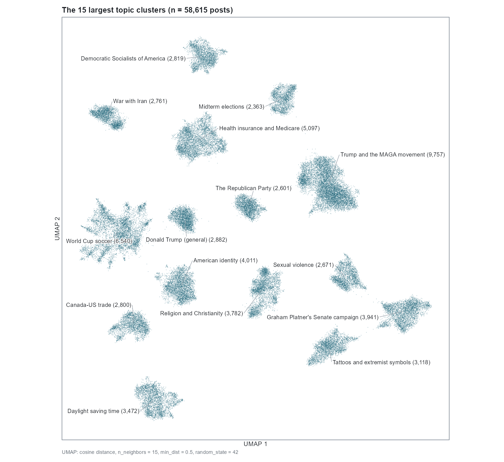

# Methods and results

What each phase did and what it measured. The numbers come from the reports each run wrote.
The data are every submission and comment posted to `r/politics` in July 2026 (UTC), from
publicly available Reddit data. Everything ran on one NVIDIA RTX 3090 (24 GiB) under WSL2
Ubuntu 24.04.

## Phase 1: message-event table (R)

Folder: `pipeline/phase1_message_event_foundation/`

The script combines 7 comment files (891,397 rows) and 1 submission file (10,747 rows) into
one table with 902,144 rows and 29 columns, one row per message. It adds a key for each
message (`doc_key`, the Reddit fullname), links each comment to its thread and parent with
flags for whether those are in the data set, and records the source file and row of each
message. No rows are removed or filtered, and the text is left as it is. The source files are
hashed before and after the run to confirm they were not changed. Every column is described
in [`DATA_DICTIONARY.md`](DATA_DICTIONARY.md).

## Phase 2: embeddings (Python)

Folder: `pipeline/phase2_semantic_embeddings/`

Four smaller studies came before the full run, all with a 21 GiB limit on GPU memory:

| Study | Question | Result |
|---|---|---|
| `feasibility_qwen3_embedding_worst_case` | Can Qwen3-Embedding-4B and 8B embed the longest documents (up to 5,823 tokens)? | Both handled the longest document and a batch of the three longest. On a batch of the eight longest, the 4B fit and the 8B ran out of memory. The two models' tokenizers are identical, so one token count works for both. |
| `feasibility_tei_qwen3_4b_batch_tokens` | Largest `max_batch_tokens` for the 4B model in Text Embeddings Inference | 92,160 tokens (peak 20.8 GiB). The next value tested, 92,672, went over the limit. |
| `benchmark_qwen3_4b_0p6b_throughput` | GPU vs CPU speed on the same three documents | For the 0.6B model the GPU was 88.6 times faster (11,925 vs 135 tokens/s). |
| `faiss_gpu_exact_search_benchmark` | How long does exact nearest-neighbor search take? | 1.3 s to build the index; about 1.5 minutes projected to search all 902,144 documents. |

Text Embeddings Inference has no setting to limit its GPU memory, so the batch-size study
used `vram_cap` (`feasibility_tei_qwen3_4b_batch_tokens/scripts/vram_cap/`). `vram_cap.c` is
loaded in place of the CUDA driver library. It passes every call through to the real driver
and refuses any allocation that would take the process past a set limit, which is what
PyTorch's `set_per_process_memory_fraction` does for PyTorch programs.
`gen_trampolines.py` generates the pass-through functions for the rest of the driver.

After a trial run on three days of data, the full run (`full_corpus_embedding_0p6b`) used
Qwen3-Embedding-0.6B in float16 with last-token pooling, L2 normalization and no
truncation. It embedded 902,144 documents (35,388,381 tokens) in 15 minutes, about 38,250
tokens per second, with a peak of 18.4 GiB of GPU memory. The run checks that every
`doc_key` has exactly one finite 1,024-dimension embedding and that the token total matches
the token count table. One message is empty; it was embedded from a single space because the
server rejects empty input, and the report records this.

## Phase 3: clustering (Python)

Folder: `pipeline/phase3_blind_semantic_structure_discovery/`

UMAP reduces the embeddings from 1,024 to 5 dimensions (cosine distance), and HDBSCAN
clusters the result, both on the GPU with RAPIDS cuML. A separate 2-D UMAP is used only for
plots. On the full corpus the three fits took 121 seconds together, with a peak of 4.9 GiB
of GPU memory. HDBSCAN found 5,167 clusters. 457,880 documents (50.8%) were assigned to a
cluster and 444,264 were left as noise. The median cluster has 26 documents and the largest
has 24,862.

A trial on three days of data (101,722 documents) was run first. Afterwards, a sensitivity
and stability study on the same three days changed one UMAP or HDBSCAN setting at a time and
repeated the baseline five times. The run checks that every output row still lines up with its
`doc_key`, that all coordinates are finite, and that the input embeddings were not changed.
The clusters are not named or interpreted in this phase.

## Phase 4: cluster description (R)

Folder: `pipeline/phase4_semantic_structure_description_qc/`

- 4a links each cluster back to its messages, computes c-TF-IDF keywords for each cluster,
  and picks representative messages (those nearest the cluster centroid and those with the
  highest membership probability), with the parent comment for context.
- 4b summarizes each cluster's authors, timing, threads, links and reply context, and runs
  automated quality checks. There is no randomness, and ties are broken by fixed rules.
- 4c picks a sample of clusters (the largest plus a random set) and builds a package for
  each one for manual review. The manual review is the next step.
- 4d names the 15 largest topic clusters from their keywords, leaving out the removed-post
  placeholder cluster, and marks them on the map along with the islands outside the main
  mass. It also re-embeds those topics' 58,615 posts in a new 2-D UMAP (cosine, 15
  neighbors, min_dist 0.5, fixed seed), which is used only for the figure below.

Phases 1 to 4 do not try to detect coordination or disinformation. That comes after the
clusters have been described and checked by hand.

## Reproducibility

- Input files are only read, and they are hashed before and after each run.
- Each output has a `.manifest.yml` file next to it with the input and output hashes, the
  script's hash, the parameters, the git commit and the package versions.
- Random seeds are fixed where randomness is used. UMAP is left unseeded on purpose, and that
  is recorded.
- Each script records how long it ran and its peak memory.
- The functions each script uses are unit-tested separately from the full run.
