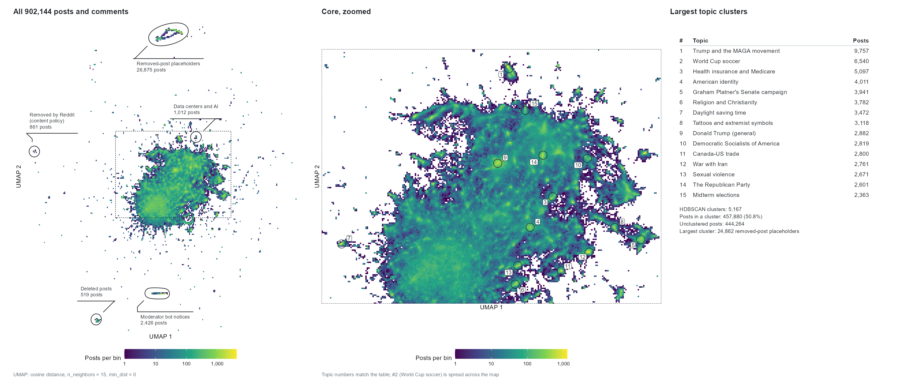
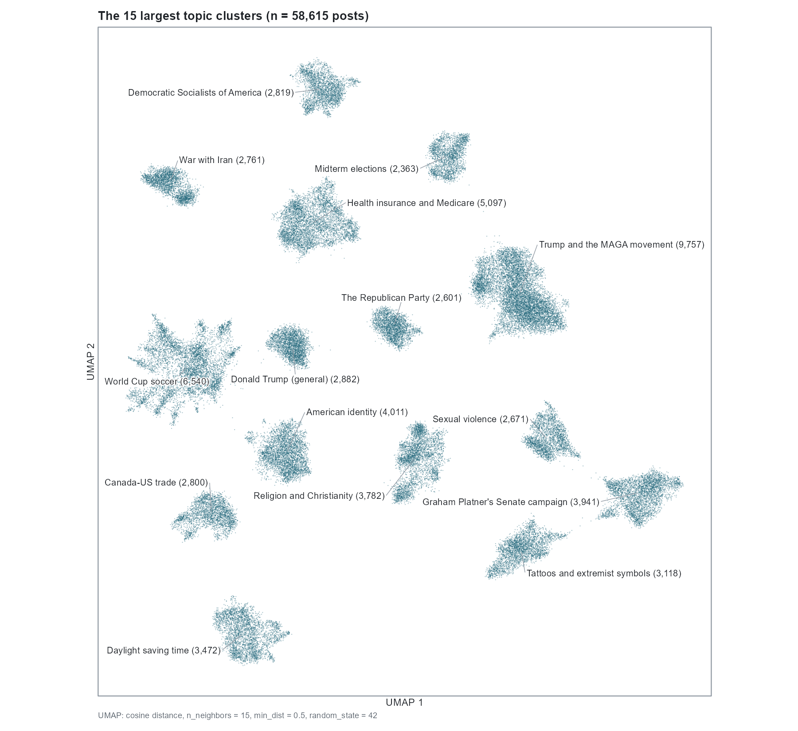

# 4d: topic figures

Figures for the largest topic clusters. The 15 largest clusters, leaving out the removed-post
placeholder cluster, were named by hand from their c-TF-IDF keywords (4a). A few islands
outside the main mass of the map were named the same way.

## Results



- Most posts sit in one continuous mass. The separate islands around it are removed-post
  placeholders (26,875 posts), automated moderator notices (2,426), posts removed by Reddit
  under its content policy (861) and deleted posts (519), plus one topic island, data centers
  and AI (1,012).
- The 15 largest topics range from 9,757 posts (Trump and the MAGA movement) to 2,363
  (midterm elections). Except for the World Cup, each sits in one small area of the core.



- Re-embedding only these 58,615 posts gives one island per topic. Some islands have their own
  sub-structure, for example two lobes in Trump and the MAGA movement and branches in the
  World Cup. Because the posts were chosen by cluster, the islands are separate by design,
  and the distances between them carry no meaning.

## Scripts

| Script | What it does |
|---|---|
| `run_top_topics_umap.py` | Picks the 15 largest clusters and fits a new 2-D UMAP to their embeddings on the GPU (cuML) at min_dist 0.0, 0.3 and 0.5. Writes one parquet per setting with a manifest, and `summary.json` |
| `make_topic_figures.R` | Draws both figures from the Phase 3 coordinates and labels and the 4d results |

## Settings

```
Topic selection  15 largest HDBSCAN clusters; cluster 160 ("[removed]" placeholders) left out
UMAP (2-D)       n_neighbors=15, n_components=2, metric=cosine, random_state=42,
                 min_dist in {0.0, 0.3, 0.5}; the figure uses 0.5
```

The fits took 1 to 3 seconds each on the RTX 3090. The coordinates are for figures only and
are not used for clustering.

## Run

From the repository root, after Phases 2, 3 and 4a:

```bash
python pipeline/phase4_semantic_structure_description_qc/4d_topic_figures/scripts/run_top_topics_umap.py
Rscript pipeline/phase4_semantic_structure_description_qc/4d_topic_figures/scripts/make_topic_figures.R
```

The Python step needs the Phase 3 environment (`environment/requirements-clustering.txt`).
Unit tests for its helper functions are in `tests/` and need only NumPy.
